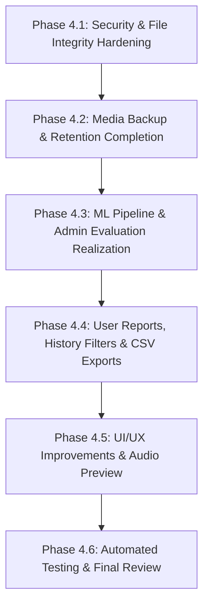

# HeartSound AI — Incremental Implementation Plan (PHASE 3)

**Project Name:** AI-Powered Heart Sound Disease Detection System  
**Document:** Phased Execution Roadmap & Verification Protocol  
**Guiding Principle:** Safe, incremental enhancements preserving 100% of existing functionality, data records, migrations, and model artifacts.

---

## 1. Implementation Philosophy & Guardrails

1. **Zero Data Loss:** Never alter or delete `db.sqlite3`, existing user records (5 active patient/admin accounts), user audio files in `media/heart_sounds/`, or trained model pickles in `ml_models/`.
2. **Backward Compatibility:** All model changes and migrations must be additive and backward-compatible.
3. **Small Testable Increments:** Each step is tested immediately with Django system checks and unit tests before moving to the next.
4. **No Disruption of Working Pipelines:** The existing audio ingestion, Librosa feature extraction (190 features), and RandomForest prediction pipeline remain active throughout.

---

## 2. Phased Roadmap Overview

---

## 3. Detailed Phase Breakdown

### Phase 4.1: Security & File Integrity Hardening
- **Objective:** Secure application secrets and eliminate disk storage leaks from orphaned files.
- **Tasks:**
  1. Generate a cryptographically random 50-character secret key and configure it in `.env`.
  2. Implement a `post_delete` signal receiver for `AnalysisRecord` to ensure `waveform_image` and `spectrogram_image` files in `media/analysis_plots/` are removed from the filesystem when an analysis or recording is deleted.
  3. Validate unauthenticated and cross-user access restrictions across all endpoints.
- **Files Modified:**
  - `.env`
  - `heart_analysis/models.py` (or signal handlers)
- **Verification:**
  - Create a test analysis, delete it, and verify that all associated plot files are deleted from `media/analysis_plots/`.

---

### Phase 4.2: Media Backup & Retention System Completion
- **Objective:** Upgrade the automated backup command to protect user audio uploads and generated spectrogram plots alongside the SQLite database.
- **Tasks:**
  1. Update `core/management/commands/backup_data.py` to create a timestamped compressed ZIP archive containing:
     - `db.sqlite3`
     - Entire `media/` folder (`heart_sounds/` and `analysis_plots/`)
  2. Apply the retention policy to clean up both database backups and media archive zip files older than the specified retention window (default 30 days).
  3. Log the backup operation with total byte count to `AuditLog`.
- **Files Modified:**
  - `core/management/commands/backup_data.py`
- **Verification:**
  - Execute `python manage.py backup_data --retention-days 30`.
  - Verify that a valid archive containing both database and media files is created in `backups/`.

---

### Phase 4.3: ML Pipeline & Admin Evaluation Realization
- **Objective:** Replace administrative mock stubs with live model evaluation and database tracking.
- **Tasks:**
  1. Update `admin_portal/views.py:model_run_eval_view` to execute `ml_pipeline/evaluation.py` programmatically against the held-out dataset.
  2. Populate the `heart_analysis_modelmetadata` database table with the evaluation results (Accuracy, Sensitivity, Specificity, F1-Score, Confusion Matrix, Dataset size).
  3. Update `admin_portal/templates/admin_portal/ml_models/model_management.html` to display the latest live benchmark run directly from the database model.
- **Files Modified:**
  - `admin_portal/views.py`
  - `ml_pipeline/evaluation.py`
  - `templates/admin_portal/ml_models/model_management.html`
- **Verification:**
  - Trigger model evaluation via the Admin Portal UI and verify that fresh metrics and confusion matrix values are recorded and rendered without errors.

---

### Phase 4.4: User Reports, History Filters & CSV Exports
- **Objective:** Provide patients with comprehensive data export options and enhance searchability.
- **Tasks:**
  1. Implement `export_user_analyses_csv` in `heart_analysis/views.py` allowing authenticated patients to export their personal screening history (UUID, Date, Classification, Confidence, Duration).
  2. Implement `export_user_assessments_csv` in `assessments/views.py` allowing patients to export their symptom questionnaire history.
  3. Add search, status filter, and classification filter controls to `templates/heart_analysis/history.html`.
  4. Implement actual PDF regeneration logic in `admin_portal/views.py:report_regenerate_view`.
- **Files Modified:**
  - `heart_analysis/views.py`, `heart_analysis/urls.py`
  - `assessments/views.py`, `assessments/urls.py`
  - `admin_portal/views.py`
  - `templates/heart_analysis/history.html`
- **Verification:**
  - Log in as a standard user, filter analysis history by status/date, and download the personal CSV report.

---

### Phase 4.5: UI/UX Improvements & Audio Preview
- **Objective:** Improve upload feedback, audio preview, and patient educational context.
- **Tasks:**
  1. Enhance `heart_analysis/upload.html` with an HTML5 audio playback widget so users can listen to their chosen file or browser recording before submitting.
  2. Implement an active multi-step progress bar during file submission ("Uploading &rarr; Preprocessing Audio &rarr; Feature Extraction &rarr; ML Inference").
  3. Add an educational reference section under `core` or `heart_analysis` with cardiac sound information (Normal S1/S2 Lub-Dub vs Murmur explanations).
  4. Ensure smooth responsive presentation on mobile, tablet, and desktop viewports.
- **Files Modified:**
  - `templates/heart_analysis/upload.html`
  - `static/js/main.js`
  - `static/css/main.css`
- **Verification:**
  - Test audio upload on desktop and mobile viewports with playback preview and multi-step loader.

---

### Phase 4.6: Automated Testing & Final Review
- **Objective:** Verify end-to-end stability, performance, and documentation completeness.
- **Tasks:**
  1. Extend `tests/test_all.py` with test cases for:
     - Media backup archive creation
     - Orphaned plot file cleanup on analysis deletion
     - User-facing CSV exports and data isolation
     - Live model evaluation execution
  2. Run Django checks and the full automated test suite:
     - `python manage.py check`
     - `python manage.py test`
  3. Generate final documentation:
     - `CHANGELOG.md`
     - `TESTING_REPORT.md`
     - Updated `README.md`
- **Verification:**
  - 100% test pass rate with zero regressions in existing working modules.

---

## 4. Rollback and Safety Strategy

- Before each phase, git commits ensure an exact rollback point.
- SQLite backups exist in `backups/` and can be restored immediately in case of database errors.
- No migrations will alter primary keys or delete columns from existing tables.
