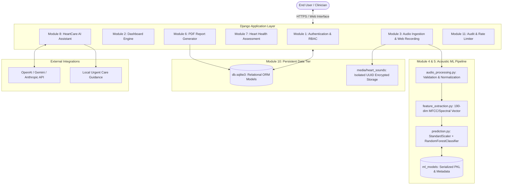
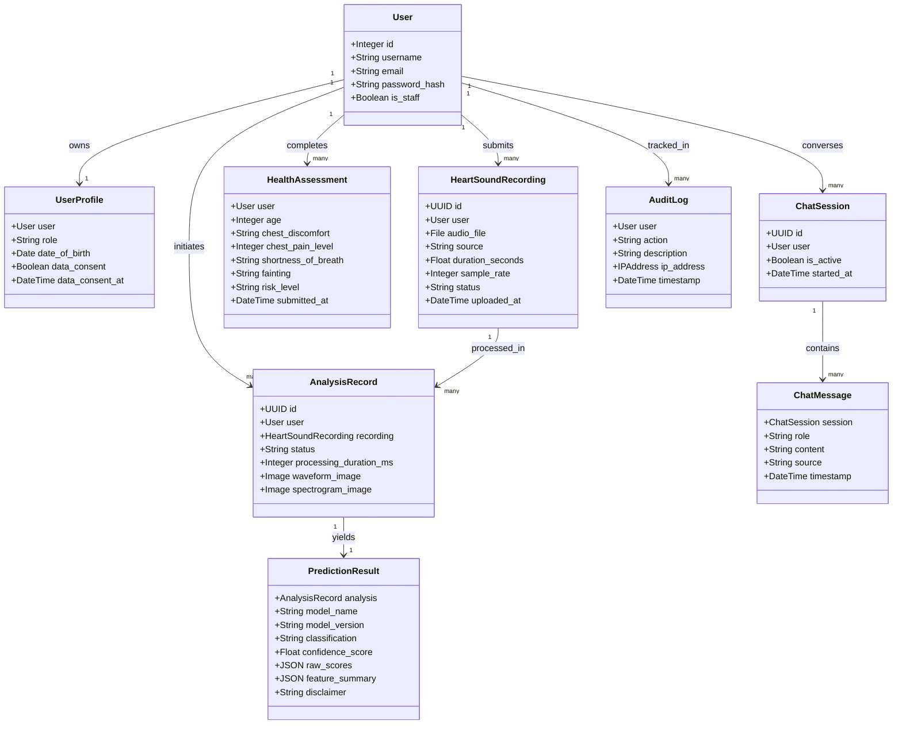
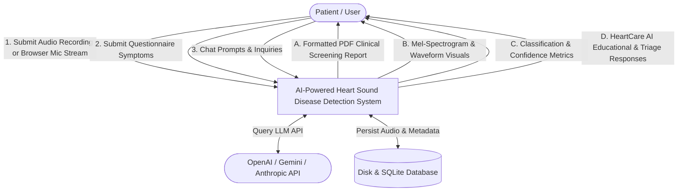
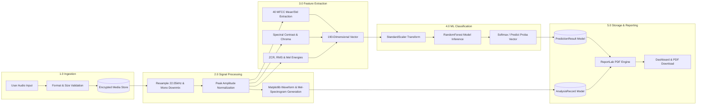

# System Architecture & Technical Specification

## 1. High-Level Architectural Overview

The **AI-Powered Heart Sound Disease Detection System** is structured as an enterprise-grade multi-tier Django web application coupled with a modular audio signal processing and machine learning inference engine.

---

## 2. Ontology Graph

---

## 3. Data Flow Diagrams

### Level 0 DFD (Context Diagram)

### Level 1 DFD (Decomposed Module Flow)

