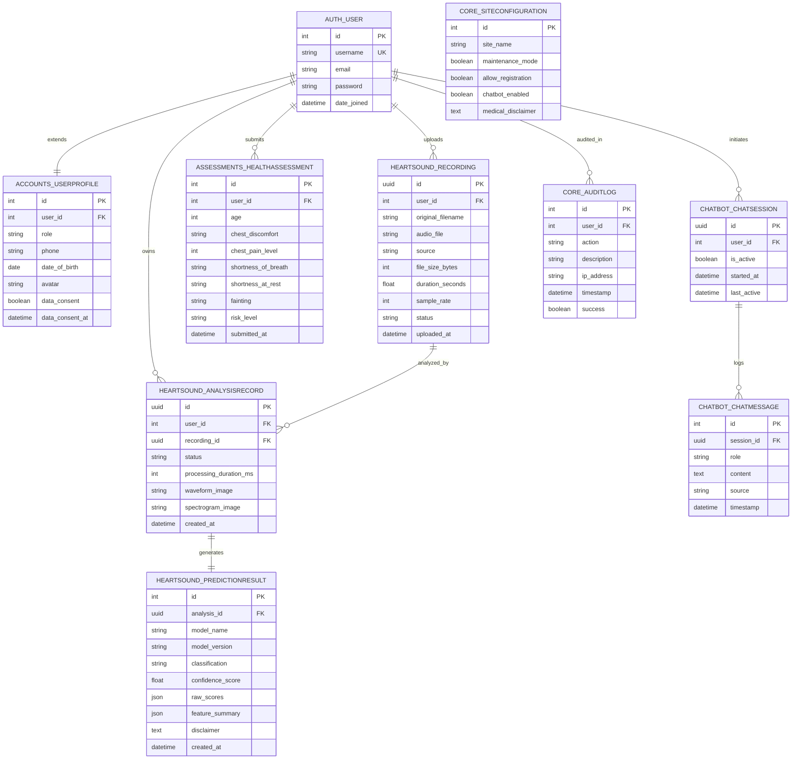

# Database Schema & Entity-Relationship Specification

## 1. Relational Database Overview

The application utilizes **SQLite 3** via the **Django Object-Relational Mapper (ORM)**. The schema is organized into normalized relational tables enforcing referential integrity, cascading deletion policies for patient records, and database indexing on frequently queried columns.

---

## 2. Table Schemas and Constraints

### Table: `accounts_userprofile`
| Column | Type | Constraints | Description |
|---|---|---|---|
| `id` | BigAutoField | PRIMARY KEY | Unique ID |
| `user_id` | ForeignKey(`auth_user`) | ON DELETE CASCADE, UNIQUE | Linked Django User |
| `role` | CharField(20) | Choices: `user`, `admin` | User authorization role |
| `phone` | CharField(20) | BLANK=True | User phone contact |
| `date_of_birth` | DateField | NULL=True | Birthday |
| `avatar` | ImageField | Uploads to `avatars/` | Profile picture |
| `data_consent` | BooleanField | DEFAULT=False | Patient research consent flag |
| `data_consent_at` | DateTimeField | NULL=True | Timestamp of legal consent |

### Table: `heart_analysis_heartsoundrecording`
| Column | Type | Constraints | Description |
|---|---|---|---|
| `id` | UUIDField | PRIMARY KEY, DEFAULT=uuid4 | UUID recording identifier |
| `user_id` | ForeignKey(`auth_user`) | ON DELETE CASCADE | Recording owner |
| `audio_file` | FileField | Validators: WAV, FLAC, MP3, OGG, AIFF | Path to audio on disk |
| `source` | CharField(20) | Choices: `upload`, `browser` | Ingestion method |
| `duration_seconds` | FloatField | NULL=True | Audio duration in seconds |
| `sample_rate` | IntegerField | NULL=True | Ingested audio sample rate |
| `status` | CharField(20) | Choices: `pending`, `processing`, `ready`, `error` | Processing state |
| `uploaded_at` | DateTimeField | AUTO_NOW_ADD=True, INDEX | Ingestion timestamp |

### Table: `heart_analysis_analysisrecord`
| Column | Type | Constraints | Description |
|---|---|---|---|
| `id` | UUIDField | PRIMARY KEY, DEFAULT=uuid4 | Analysis tracking UUID |
| `user_id` | ForeignKey(`auth_user`) | ON DELETE CASCADE | Associated user |
| `recording_id` | ForeignKey(`heartsoundrecording`) | ON DELETE CASCADE | Associated sound file |
| `status` | CharField(30) | Choices: `queued`, `processing`, `completed`, `failed`, `model_unavailable` | Job status |
| `processing_duration_ms` | IntegerField | NULL=True | Total execution time (ms) |
| `waveform_image` | ImageField | Uploads to `analysis_plots/` | Time-domain plot |
| `spectrogram_image` | ImageField | Uploads to `analysis_plots/` | Frequency-domain mel plot |

### Table: `heart_analysis_predictionresult`
| Column | Type | Constraints | Description |
|---|---|---|---|
| `id` | BigAutoField | PRIMARY KEY | Unique prediction record ID |
| `analysis_id` | OneToOneField(`analysisrecord`) | ON DELETE CASCADE | Linked analysis job |
| `model_name` | CharField(100) | Default: `HeartSoundClassifier` | Model algorithm identifier |
| `model_version` | CharField(50) | Version string | Tracking version |
| `classification` | CharField(30) | Choices: `normal`, `abnormal`, `uncertain`, `model_unavailable` | Category |
| `confidence_score` | FloatField | NULL=True | Probability score (0.0 to 1.0) |
| `raw_scores` | JSONField | NULL=True | Full multi-class probability map |
| `feature_summary` | JSONField | NULL=True | Audit summary of 190-dim features |
| `disclaimer` | TextField | Required | Mandatory legal disclaimer |
